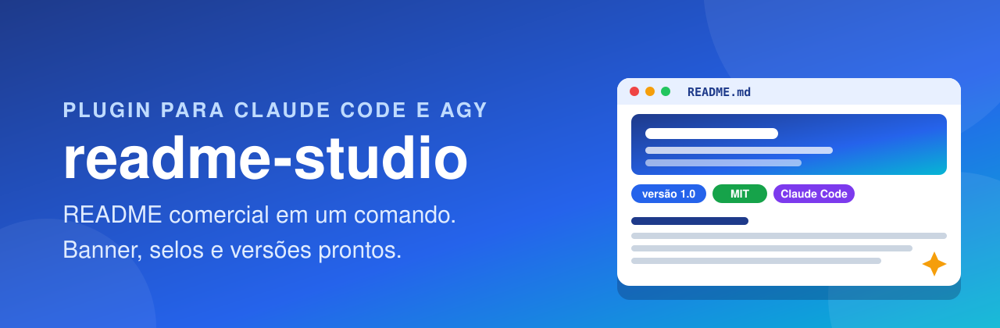

<p align="center">
  
</p>

<p align="center">
  
  
  
  
</p>

<h3 align="center">README comercial em um comando.<br>Banner, selos e versões prontos.</h3>

---

## O que é

O **readme-studio** cria o README de um projeto com cara de produto: banner bonito no topo, selos de versão e licença, tabelas de instalação e uso e uma lista de versões.

Ele lê o seu projeto, pergunta só o que faltar, mostra o plano e só grava depois do seu "sim".

## Por que usar

| | |
|---|---|
| 🎨 **Banner que sempre cabe** | Um script calcula o tamanho da fonte, então o texto nunca sai da imagem. |
| 🏷️ **Selos e versões** | Versão, licença e a tabela de versões a partir das tags do git. |
| 🗣️ **Linguagem simples** | Texto para leigos, com comandos copiáveis. |
| 🛡️ **Sem invenção** | Não inventa funcionalidades, números nem depoimentos. |

## Antes de começar

- **Claude Code** ou **agy (Antigravity)**.
- **Python 3** instalado (só para gerar o banner).

## Instalação

### No Claude Code

```
/plugin marketplace add nathanramorim/readme-studio
/plugin install readme-studio@readme-studio
```

### No agy (Antigravity)

```bash
git clone https://github.com/nathanramorim/readme-studio.git
mkdir -p .agents/skills
cp -R readme-studio/skills/readme-comercial .agents/skills/
cp -R readme-studio/scripts readme-studio/templates .agents/skills/readme-comercial/
```

> Teste no seu agy: o plugin usa a pasta `.agents/skills/` do projeto. Se o seu agy usar outro local, copie para lá. Neste caso, o script e os templates ficam dentro da pasta da skill.

## Como usar

| Claude Code | agy |
|---|---|
| `/readme-gerar` | "Gere o README comercial deste projeto" |

Ele pergunta nome, frase de valor, cores e três rótulos para o banner. Depois mostra o que vai criar e espera a confirmação.

### Só o banner

```bash
python3 scripts/gerar_banner.py \
  --nome meu-projeto --kicker "Plugin para X" \
  --linha1 "Frase de valor." --linha2 "Segunda frase." \
  --rotulos "Pasta A|Pasta B|Pasta C" \
  --cores "#1e3a8a,#2563eb,#06b6d4" --saida docs/banner.svg
```

## Segurança e privacidade

- Não faz commit nem push sozinho.
- Guarda o README antigo em `README.antigo.md` antes de substituir.
- Não coloca e-mails, caminhos pessoais nem segredos no texto.

## Versões

| Versão | Novidades |
|---|---|
| **0.1.0** | Primeira versão: `/readme-gerar`, skill `readme-comercial`, gerador de banner e template de README. |

## Licença

[MIT](LICENSE)
