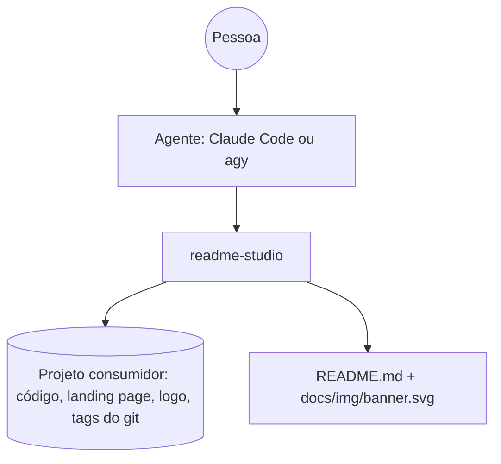
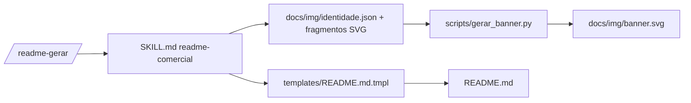

# Overview — readme-studio

Plugin (Claude Code e agy) com a skill `readme-comercial` e o comando `/readme-gerar`: o agente lê o projeto consumidor, descobre a identidade visual dele, pergunta só o que falta, mostra o plano e, depois do "sim", gera o `README.md` pelo template e o banner SVG pelo `gerar_banner.py`, com texto que sempre cabe.

## Índice
- `stack.md` — tecnologias
- `modules.md` — componentes
- `flows.md` — fluxos principais
- `decisions.md` — decisões de design

---

## Arquitetura (C4 Model)

### Nível 1: Contexto

### Nível 2: Containers

